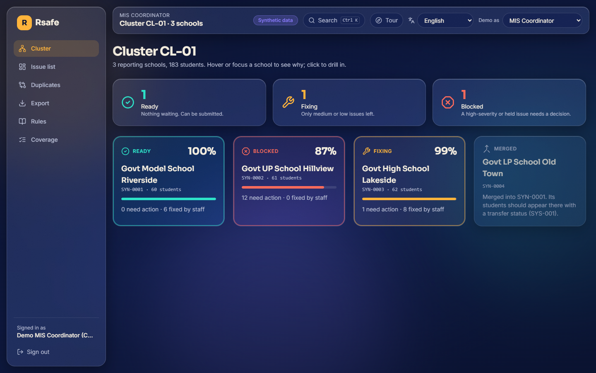
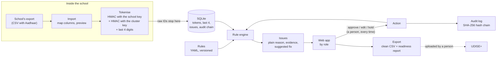

# Rsafe

**Every record, right before it counts.**

**Live demo: [rsafe.onrender.com](https://rsafe.onrender.com)**. Pick any role; nothing to install. It
runs on a free instance that sleeps when idle, so the first visit can take up to a minute to load.

Rsafe checks a school's student, teacher and facility records before they are submitted to UDISE+. It runs
versioned rules, explains each problem in plain language, suggests a fix, holds risky flags for a person
to decide, finds the same child enrolled in two schools without sharing raw IDs, keeps a tamper-evident
audit log, and exports a clean file with a readiness score. It never changes or submits anything by itself.

> **Prototype on synthetic data.** All names, schools and ID numbers are generated. Rsafe does not verify
> Aadhaar, makes no calls to UIDAI or any government portal, and the parent confirmation flow is a mockup.



Team **kabhijith447** · PRASUNEX INNOVATHON 2026 (Round 3)

## The problem

Schools enter records into UDISE+ once a year, often from a spreadsheet kept by one person. Records come
back rejected or, worse, are accepted wrong:

- **Names and dates:** names spelled differently from the admission register, and dates of birth that
  cannot be read or put a child in the wrong class.
- **Duplicates:** the same child entered twice, or still enrolled at a school they have left.
- **Dropouts:** children marked as dropouts while still attending. That can cut them off from benefits.
- **Merged schools:** students of merged or closed schools with no transfer recorded, so they vanish from
  both schools' counts.
- **Staff and buildings:** teachers assigned outside their subject, and facilities marked "functional"
  while a repair is open.

Each of these is cheap to fix before submission and expensive after. Rsafe catches them while the school
can still fix them, and leaves every decision to a person.

## Run it

Requires Python 3.11+ and Node 18+. Works on Windows, macOS and Linux.

```
npm run setup   # once: Python venv, dependencies, synthetic data, database
npm run dev     # web http://127.0.0.1:5173, api http://127.0.0.1:8765
```

Open http://127.0.0.1:5173. **Enter Rsafe** lets you pick a demo role. For a guided five-minute run, follow
[DEMO_SCRIPT.md](DEMO_SCRIPT.md).

| Command | What it does |
|---|---|
| `npm run test` | 246 backend tests (about 20 to 45 s) |
| `npm run seed` | rebuild the synthetic data and database. This also resets the demo. |
| `npm run build` | type-check and build the frontend |
| `npm run bench` | time validation on about 5,000 synthetic students (throwaway database) |
| `npm run screenshots` | regenerate the landing-page images (throwaway database, its own ports 8766 and 5174) |

`make <target>` and `./run.sh <target>` run the same commands.

## Deploy

Rsafe deploys as **one Docker container**: the API serves the built frontend on a single port, so the
app has one URL and its session cookie is same-origin. On every start the container builds fresh
synthetic data, so a restarted deployment is a clean demo.

**Try the container locally** (needs Docker):

```
docker build -t rsafe .
docker run --rm -p 8080:8000 rsafe     # then open http://localhost:8080
```

**Free hosting on Render** (uses the included [render.yaml](render.yaml)):

1. Push the repository to GitHub, including `Dockerfile`, `render.yaml` and `deploy/start.sh`.
2. At [render.com](https://render.com), sign in with GitHub, choose **New > Blueprint**, and pick this
   repository. Render reads `render.yaml`: one free Docker web service, health check `/api/health`, and a
   generated `RSAFE_SESSION_SECRET`. Press **Apply**.
3. The first build takes a few minutes. Then open the `https://rsafe-….onrender.com` address Render shows.
4. Later pushes to the default branch redeploy automatically.

Things to know about the free tier (check Render's current plan details):
- It sleeps when idle and takes up to about a minute to wake on the next visit. **Open the link a few
  minutes before you present.**
- Each wake-up or redeploy starts with fresh demo data, and the audit log starts again.
- Anyone with the link can use the demo-only **Reset demo data** and **Tamper row** buttons. Set
  `RSAFE_DEMO_MODE=0` to remove them, which also removes the tamper demo.

**Any other Docker host** (Railway, Fly.io, a VM): build the `Dockerfile` and set these if needed.

| Variable | Default in the image | Meaning |
|---|---|---|
| `PORT` | `8000` | Port the server listens on; most hosts set it for you |
| `RSAFE_SESSION_SECRET` | random per start | Signs the session cookie. Set a fixed long random value so sign-ins survive restarts |
| `RSAFE_DEMO_MODE` | `1` | `0` removes the Reset and Tamper demo buttons |
| `RSAFE_COOKIE_SECURE` | `1` | Session cookie only over HTTPS (and `localhost`). Set `0` only for plain HTTP on another address |

The deployed app holds synthetic data only and makes no outside calls.

## Who uses it (demo roles)

| Role | Home screen | Can |
|---|---|---|
| Principal | Dashboard | see their school, approve, edit or hold any issue, upload, export, run validation |
| Teacher | My classes | see only the students they teach (and their own record), approve or edit those issues |
| MIS Coordinator | Cluster | see every school in the cluster as ready, fixing or blocked, drill in, export |
| Admin | Audit log | read and verify the audit log, see all schools and rules |
| Student and Parent | My record | see one child's record and what is being checked, confirm or report a mistake (mockup) |

The role switcher in the top bar changes role, and for Principal and Teacher, the school. Roles are
enforced on the server for every request:

- **No session:** 401.
- **Wrong role:** 403.
- **Record outside your scope:** 404, the same answer as for a record that does not exist.

The UI hides what you cannot use, but it is not what protects the data.

## How it works



1. **Import.** The Principal drops in the school's own export. Rsafe suggests a column mapping and shows
   blocking errors (wrong school, missing or duplicate IDs) and warnings by row. Nothing is saved until a
   person confirms.
2. **Check.** Every rule runs over every record. Each problem becomes an issue with the rule ID and
   version, a plain-language reason, the evidence the rule used, a confidence note and, where possible, a
   suggested value.
3. **Review.** A person approves the fix, edits the value, or holds the issue. Dropout flags (STU-008) start
   held and are never applied automatically. Each action is written to the audit log, then validation
   re-runs. A fixed value that goes wrong again reopens its issue.
4. **Submit.** Export the cleaned CSV and a one-page readiness report. A person uploads them to UDISE+.

**Readiness score:** the share of records with no open problem. Each record counts once, by its worst open
issue: high removes the whole record, medium half and low a fifth. Held issues count as open.

**Cluster status:**
- **Blocked:** any high-severity or held issue is open.
- **Fixing:** only medium or low issues are left.
- **Ready:** nothing is waiting.

### Stack

- **Backend:** FastAPI, SQLModel on SQLite, Pydantic v2 and PyYAML. Demo sessions are a signed cookie
  (itsdangerous). Tests use pytest.
- **Frontend:** Vite, React 18, TypeScript, Tailwind CSS v4, Framer Motion, lucide icons and self-hosted
  fonts. There are no external requests at runtime.
- **No paid services, API keys or external calls.**

```
backend/
  app/routes/      HTTP API (session, issues, upload, export, audit, rules, views)
  app/services/    rule engine, checks, tokens, keys, validation, actions, audit, upload, export
  rules/           one YAML file per rule (see rules/README.md)
  data/            the committed synthetic dataset
  tests/           pytest suite
  seed.py          synthetic data generator
  bench.py         validation benchmark
frontend/src/
  pages/           landing, role picker, and app screens
  components/      glass design system (cards, buttons, panels, tables, toasts)
scripts/           cross-platform npm tasks and the screenshot pipeline
```

## Rules

All 11 rules are YAML files in [backend/rules/](backend/rules/). Each declares an ID, a version, a
severity, the check it uses, the government failure reason it addresses, the message and the fix. Every
issue is stamped with the version of the rule that raised it, and the Rules screen lists them all.

| ID | Checks | Severity | Addresses |
|---|---|---|---|
| STU-001 | Student name missing or malformed | high | Name or spelling mismatch |
| STU-002 | Date of birth missing, unreadable or outside the class's age band | high | Date of birth problems |
| STU-003 | Gender missing or different from last year | medium | Gender discrepancy |
| STU-004 | Aadhaar missing or update pending | high | Missing Aadhaar |
| STU-005 | Name spelled differently from the admission register | medium | Name or spelling mismatch |
| STU-006 | Same student entered twice in one school (school token) | high | Duplicate enrolment |
| STU-007 | Same student enrolled in two schools (cluster match token) | high | Duplicate enrolment |
| STU-008 | Dropout flag contradicted by recent attendance or fees (**held for review**) | high | Wrong dropout or closure status |
| SYS-001 | Transfer status missing after a school closure or merger | high | School closure or merger gaps |
| TCH-001 | Teacher assigned outside their subject | medium | Teacher data mismatch |
| FAC-001 | Facility status contradicts the maintenance log | medium | Facility data mismatch |

Each rule has tests for both passing and failing records. A ground-truth test also checks that, on the
seeded data, the rules flag exactly the problems the generator injected, and nothing else.

## Privacy design (and its limits)

**Raw IDs stop at the school.** When a school file is imported, each Aadhaar number is turned into two
keyed tokens and the last four digits, and the number itself is dropped
([backend/app/services/ingest.py](backend/app/services/ingest.py)). Nothing after that point holds it:
not the database, the API, the audit log or the exports.

A test ([backend/tests/test_privacy.py](backend/tests/test_privacy.py)) proves this:
- It dumps every table, scans the raw database file, and calls every API route.
- It fails if any 12-digit number, or any of the seeded IDs, appears.

| Token | Formula | Used for |
|---|---|---|
| School token | `HMAC_SHA256(school_key, aadhaar)` | duplicates inside one school (STU-006) |
| Match token | `HMAC_SHA256(cluster_match_key, aadhaar)` | the same child in two schools (STU-007) |

- Each school has its own random key in `.keys/` (git-ignored), so school tokens cannot be compared across
  schools.
- The cluster match key is derived from a cluster master secret:
  `HMAC(master, "rsafe/match-key/v1/" + cluster_id)`.
  - Every school in a cluster computes the same match token for the same child.
  - So the platform finds cross-school duplicates by comparing tokens, never numbers or names.
- Tokens are base32 (letters and the digits 2-7 only). Unlike hex, they never produce digit runs that could
  be mistaken for an ID, or hide one.
- Screens show only the first 6 characters of a token and the last 4 digits. Free-text fields (edit
  values, notes, parent comments) refuse anything that looks like an ID number.

**Limits, stated honestly:**
- A 12-digit number space is small. Anyone who has a key can brute-force tokens back into numbers. Tokens
  are pseudonyms that protect IDs only while the keys stay secret; they are not anonymisation.
- In this prototype one machine plays both the school and the platform, so all keys sit in one folder. A
  real deployment would keep school keys at schools and give the platform no key at all.
- Cross-school matching works only inside one cluster. Children who move between clusters are not matched.
- Rotating a cluster key changes every match token; old and new tokens cannot be compared.
- Rsafe does not verify that a number is a real Aadhaar number (no Verhoeff checksum, no UIDAI call). It
  checks only that it has 12 digits.
- Names, dates of birth and guardian names are stored in plain text, as UDISE+ needs them. Only the Aadhaar
  number is tokenised.

## Nothing happens without a person

- **No automatic changes:** Rsafe never changes a record or submits a file by itself. Approve, edit and
  hold are explicit actions, each written to the audit log with the actor, role, old and new value and
  note.
- **Hash-chained audit log:** each row stores
  `hash = SHA256(prev_hash + canonical_json(ts, actor, role, action, record_ref, payload))`.
  - **Verify chain** recomputes the chain and names the first broken row.
  - The Admin screen has a **Tamper row (demo)** button that edits a row directly in the database, so
    you can watch verification catch it.
  - That button exists only with `RSAFE_DEMO_MODE=1`, which is the default for this prototype.

## Extra features

All ten optional features from the brief are built, tested and checked in the browser.

| # | Feature | Where | What it does |
|---|---|---|---|
| 1 | Demo mode | **Tour** in the top bar, "Or take the guided tour" on the landing page; Admin **System → Reset demo data** | A 10-step tour card walks the demo story, switching role and screen and outlining what to look at. Reset rebuilds the synthetic data; the new audit log starts with a row naming who reset it. |
| 2 | Test submit | **Export → Test submit** (`POST /api/submit/dry-run`) | Runs every rule again in memory and shows each row's values and verdict: would send, sent with a flag, likely rejected, or held back. Nothing is exported or changed; the check itself is audited. |
| 3 | Smart fix suggestions | Issue panel | Names and dates of birth get a proposed value only when there is evidence: the school's admission register, or an obviously swapped month and day that still fits the class. The reason is shown beside the value. **Reject suggestion** records the rejection and leaves the record untouched. |
| 4 | Why was this flagged? | Issue panel | Shows the rule version, the check that ran, the data it read, the rule's settings, and the issue's history from the audit log. |
| 5 | Hindi and Malayalam | Language picker in the top bar and on My record | Rule titles, reasons and fixes in English, हिन्दी or മലയാളം, from [backend/rules/i18n.json](backend/rules/i18n.json). Hindi and Malayalam are machine translations, labelled "Not yet reviewed" wherever they appear. Record details and the rest of the UI stay in English. |
| 6 | Readiness trend | Dashboard (Principal; MIS and Admin after picking a school) | A line of readiness after every validation run, read from the audit log. Hover or use the arrow keys to see which action caused each step; a table view is included. |
| 7 | Command palette | **Ctrl+K** (or ⌘K), or **Search** in the top bar | Jump to any screen or rule, or to a student by name or ID within your own scope (`GET /api/search`; never searches Aadhaar). |
| 8 | Printable report | **Export → Open report** | Adds an audit summary (who did what, and readiness from the first run to now) and the chain's head hash to the one-page report. |
| 9 | Rule coverage | **Coverage** (Principal, MIS, Admin) | Groups the rules by the government failure reason each addresses, with what each has found, fixed and cleared. |
| 10 | Health and metrics | `GET /api/metrics`; Admin **System** | Timing for every validation run (read, rules, store, total, per 1,000 records), counts and rule versions. Public like `/api/health`, with no names or IDs. |

**Parent requests.** When a parent presses **Something is wrong** on My record, the request appears in a
**Parent requests** panel:
- **Principal:** on the Dashboard.
- **Teacher:** on My classes, but only for the students they teach.
- **MIS Coordinator:** on the Dashboard, read-only.

Each request shows the comment and the child's issues; clicking an issue opens it to fix. **Mark as
handled** writes `request.handled` to the audit log and never changes the record. The record changes
only through Edit or Approve on an issue. The parent then sees that the school handled it, and the
report shows who handled each request (`GET /api/parent-requests`,
`POST /api/parent-requests/{id}/handled`).

The issue list's Status column also shows who decided each issue ("by Teacher", "by Principal"). Its
Status filter has five options:
- **Needs action:** open and held issues. This is the default.
- **Held for review:** held issues only.
- **Decided by a person:** approved, confirmed or edited.
- **Cleared on re-check:** the problem no longer appears when the rules run.
- **Everything:** all of the above.

## What is mocked

- **Data:** all of it is synthetic. The generator ([backend/seed.py](backend/seed.py)) uses a fixed seed and
  injects a known list of problems (`backend/data/injected.json`). Synthetic ID numbers start with 0.
- **Sign-in:** a demo role picker, not real authentication. Identities are fixed synthetic people.
- **Parent confirmation:** a mockup. The 6-digit code is shown on screen and no SMS is sent. The reply is
  saved to the audit log and never changes the record. Staff see change requests in the Parent requests
  panel.
- **UDISE+:** not contacted. Export produces files a person would upload by hand.
- **"Today":** pinned to 16 Nov 2026 (`RSAFE_TODAY`), so date-based rules give the same results on any day.
- **Translations:** the Hindi and Malayalam texts are machine translations and have not been reviewed by a
  fluent speaker.

## Measured quality

**Validation speed** (`npm run bench`, Windows 11 laptop, Python 3.13, 5,004 synthetic students, 11 rules):

| Step | Time (range over 4 runs on 23 Nov 2026) |
|---|---|
| Rule engine alone | **98 to 266 ms** (20 to 53 ms per 1,000 records) |
| Full validation (read the database, run all rules, store issues, write the audit row) | **0.69 to 1.83 s** (140 to 370 ms per 1,000 records) |
| One-time load from CSV (parse, tokenise, insert, including about 75,000 attendance rows) | 4.9 to 8.9 s |

The same code ran at both ends of each range on the same laptop; the slower runs came later in the day,
under a heavier machine state. Run `npm run bench` to measure on your own machine.

Reading the database dominates full validation. Reading plain rows instead of ORM objects halved it, from
1.3 s to 0.69 s, measured on the faster runs.

**Accessibility** (Lighthouse 13.6, desktop, Microsoft Edge): **100** on every main screen and state:
- landing, role picker
- dashboard (with the readiness trend), dashboard with the issue panel open
- upload, duplicates, export (with Test submit), rules, coverage
- my classes, cluster, school drill-in
- audit log, system, my record

**Production landing page** (Lighthouse): performance, accessibility and best practices all score 100, on
both mobile and desktop emulation.
- **LCP:** 1.5 s on mobile, 0.2 s on desktop.
- **Total transfer:** 545 KB. The screenshots are served as WebP; the full PNGs are kept as originals.

**Browser console:** no errors on any screen for any role. The only errors are the 401 and 422 responses
the server deliberately returns, for example to a wrong parent OTP code.

**Error handling:**
- When the server is unreachable, the app says so.
- An expired session returns you to the role picker.
- A screen that fails to render shows a recovery card while the navigation stays usable.

**Tests:** 253 pytest tests:
- every rule, with good and bad records, plus ground truth on the seed
- smart suggestions: register values, swapped dates, and never guessing without evidence
- token privacy
- the audit chain, including tamper detection
- role access for every route
- upload, export and views
- the extras: reset, test submit, trend, coverage, search scope, translations in sync with the rules,
  metrics without personal data, reject suggestion, the report's audit summary
- parent requests: who sees them, scope, marking handled once, and that the record never changes

## Future work

- Real sign-in (school SSO) instead of demo roles, with keys held per school on separate machines.
- A real consent and confirmation channel for parents (SMS or app), with replies back to the parent.
- Matching across clusters, through a privacy-preserving service that holds no school keys.
- More rules: teacher qualifications against posts, enrolment trends, infrastructure photos.
- Have fluent speakers review the Hindi and Malayalam texts, and translate the rest of the interface.
- Postgres and a job queue for district-scale validation. The engine is already a pure function over
  records.

Build history and decisions, phase by phase, are in [CHECKPOINTS.md](CHECKPOINTS.md).
